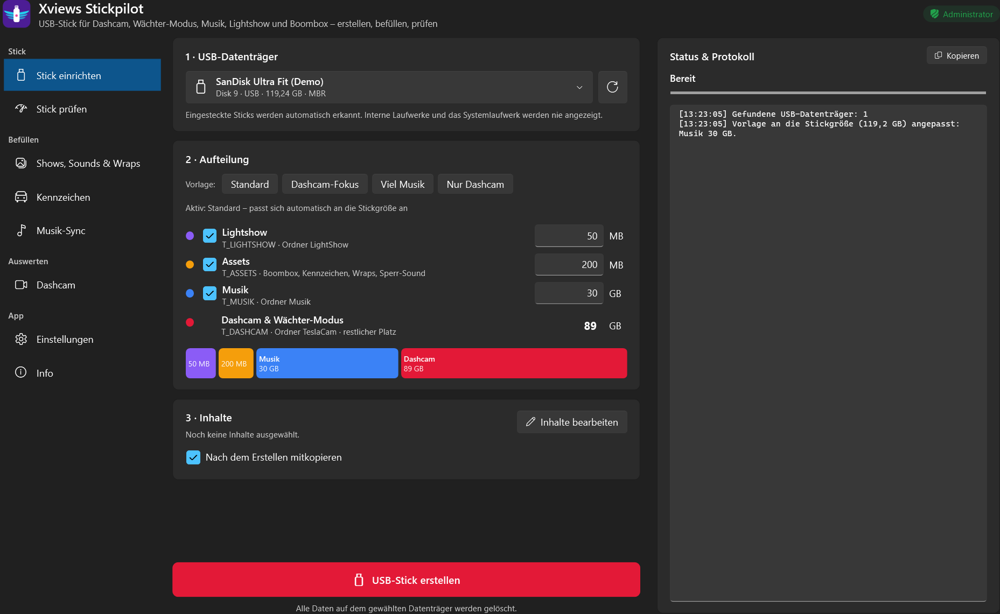
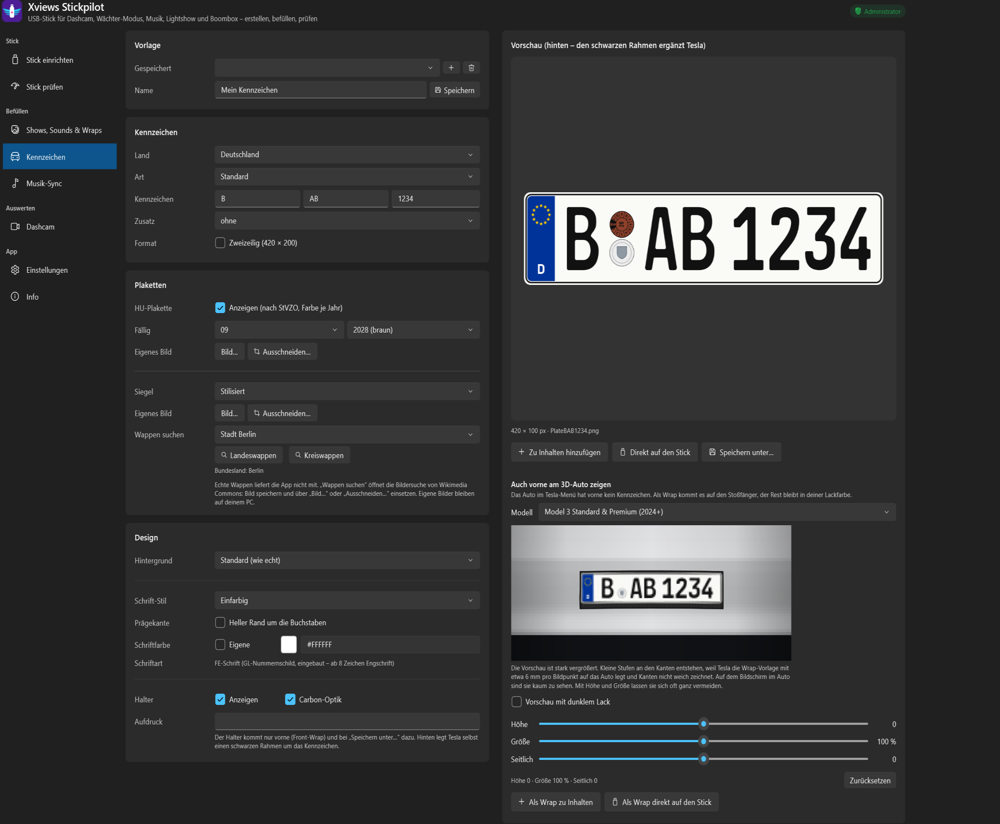
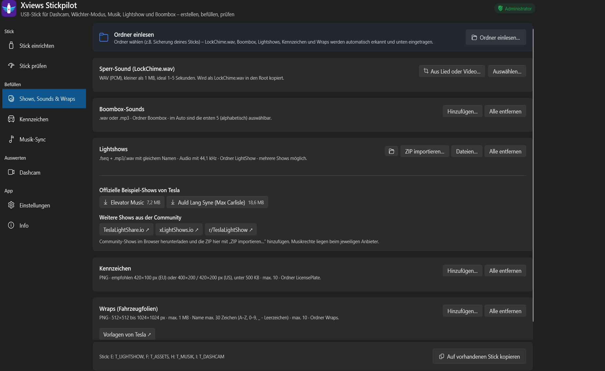
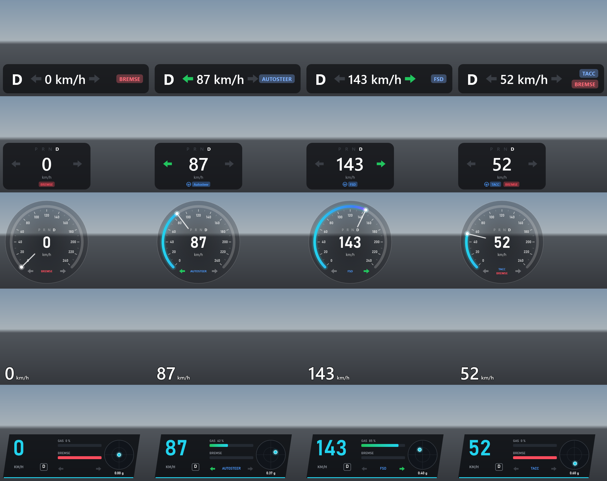

  

<h1 align="center">Xviews Stickpilot</h1>

  <b>Der USB-Stick für deinen Tesla, einfach gemacht.</b> 
  Einrichten, befüllen, prüfen. Mit Kennzeichen-Generator und Dashcam-Viewer mit Fahrdaten.

  

  <a href="#so-gehts">So geht's</a> ·
  <a href="#funktionen">Funktionen</a> ·
  <a href="#download">Download</a> ·
  <a href="#wichtig">Wichtig</a>

Privates Projekt ohne Verbindung zu Tesla, Inc. „Tesla“ ist eine Marke von Tesla, Inc.

---

Welche Ordner braucht das Auto? Warum spielt die Lightshow keinen Ton? Wieso taucht das Kennzeichen nicht auf? **Stickpilot kümmert sich um die Details:** Das kostenlose Windows-Tool richtet den kompletten Tesla-USB-Stick ein, befüllt und prüft ihn.

  

## So geht's

| 1️⃣ Einrichten | 2️⃣ Befüllen | 3️⃣ Rein ins Auto |
|---|---|---|
| Stick einstecken, Vorlage wählen. Stickpilot teilt ihn passend für Dashcam, Musik, Lightshow und Boombox auf. | Lightshows, Sounds, Wraps, Kennzeichen und Musik hinzufügen. Alles wird auf die Tesla-Vorgaben geprüft. | Stick in den Tesla stecken, fertig. Dashcam-Clips schaust du dir später mit Fahrdaten am PC an. |

## Funktionen

**Stick**
- 💾 **Stick einrichten:** Aufteilung für Dashcam und Wächter-Modus, Musik, Lightshow und Boombox. Die Vorlagen (Standard, Dashcam-Fokus, Viel Musik, Nur Dashcam) passen sich automatisch an die Stickgröße an.
- 🚀 **Stick prüfen:** Geschwindigkeitstest. Tesla verlangt für die Dashcam mindestens 4 MB/s dauerhafte Schreibrate.
- 🎵 **Musik-Sync:** überträgt nur neue und geänderte Titel.

**Shows, Sounds & Wraps**
- 💡 **Lightshows, Boombox-Sounds, Sperr-Sound (LockChime), Wraps und Kennzeichen** hinzufügen. Alles wird auf die Tesla-Vorgaben geprüft, Lightshow-Tonspuren werden bei Bedarf auf 44,1 kHz umgewandelt.
- 🔔 **Sperr-Sound-Werkstatt:** einen Ausschnitt aus einem Lied oder Video wählen, anhören, ein- und ausblenden, Lautstärke angleichen und direkt als LockChime.wav übernehmen.

**Kennzeichen-Generator**
- 🚗 **Deutschland, Österreich, Schweiz, Niederlande und USA.** Deutsche Schilder mit HU-Plakette nach StVZO (Farbe je Jahr), Stempelplakette, Saison-, Kurzzeit- und Ausfuhrkennzeichen, Carbon- oder 3D-Optik.
- 🛡️ **Front-Kennzeichen als Wrap:** Tesla zeigt am 3D-Auto vorne kein Kennzeichen. Als Wrap kommt es auf den Stoßfänger: Model 3 (ab 2017, auch Performance), Model S und Model X (ab 2021, auch Plaid), Model Y (ab 2020, auch Performance und Model Y L). Eine Vorschau zeigt vorher, wie es am Auto aussieht.
- 🏰 **Wappen suchen:** Aus dem Ortskürzel werden Kreis und Bundesland ermittelt, die Wappen-Suche öffnet sich mit einem Klick.

**Dashcam**
- 🎥 **Alle Kameras gleichzeitig**, Fahrdaten (km/h, Gang, Blinker, Bremse, Autopilot, GPS), Clips zuschneiden und exportieren. Fünf Designs für die Fahrdaten-Einblendung: Klassisch, Tesla-Stil, analoger Tacho, Minimal und Sport-HUD.
- 🗺️ **Karte mit Fahrstrecke:** die ganze Fahrt auf einer OpenStreetMap-Karte, nach Tempo eingefärbt. Ein Klick auf die Strecke springt im Video an diese Stelle, Export als GPX-Datei.
- 📈 **Tempo-Verlauf** über der Zeitleiste, mit Bremsphasen. Ein Klick springt an die Stelle.
- 🔐 **Verschlüsselte Clips (ab Update 2026.20):** mit deinem Tesla-Konto direkt in der App entschlüsseln und abspielen. Alternativ öffnet die App auch den ZIP-Download von dashcam.tesla.com.

**Außerdem**
- 🔄 **Updates mit einem Klick:** Die App meldet neue Versionen, lädt sie nach Rückfrage, prüft die Prüfsumme und startet neu. Einstellungen und Vorlagen bleiben erhalten.

<table>
  <tr>
    <td width="50%"></td>
    <td width="50%"></td>
  </tr>
  <tr>
    <td align="center">Kennzeichen-Generator</td>
    <td align="center">Shows, Sounds &amp; Wraps</td>
  </tr>
</table>

   
  Fünf Designs für die Fahrdaten-Einblendung im Dashcam-Export

## Download

| Datei | Größe | Hinweis |
|---|---|---|
| [`XviewsStickpilot.exe`](https://github.com/xviews/xviews-stickpilot/releases/latest/download/XviewsStickpilot.exe) | ca. 72 MB | läuft sofort, keine Installation, empfohlen |

**Voraussetzungen:** Windows 10 oder 11 (64 Bit). ➡️ Alle Versionen und Prüfsummen unter **[Releases](../../releases)**.

**Sicherheit:** Die Prüfsummen (SHA-256) jeder Version stehen im Release-Text. Mit `Get-FileHash .\XviewsStickpilot.exe` in PowerShell kannst du sie selbst prüfen. Jede Version wird außerdem bei VirusTotal geprüft, die Ergebnisse stehen mit Link ebenfalls im Release-Text.

<b>Beim ersten Start</b>

- Windows fragt nach **Adminrechten**. Die braucht Windows zum Formatieren des Sticks.
- Meldet SmartScreen „Unbekannter Herausgeber“, auf **„Weitere Informationen“** und dann auf **„Trotzdem ausführen“** klicken. Die EXE ist nicht signiert, weil ein Zertifikat Geld kostet.
- Einstellungen liegen in deinem Windows-Benutzerordner (`%LOCALAPPDATA%\XviewsStickpilot`), deine Inhalte (Lightshows, Kennzeichen, Sicherungen, entschlüsselte Clips) im Ordner `XviewsStickpilot` neben der EXE. Beide Orte zeigt die App unter **Info**. Startest du die App von einem USB-Stick, fragt sie einmal, ob alles auf dem Stick bleiben soll (portabel). Umstellen geht jederzeit mit einem Knopf auf der Info-Seite.

## Wichtig

- ⚠️ Beim Einrichten wird der Stick **gelöscht**, wenn du die vorhandenen Inhalte nicht behältst. Also vorher sichern.
- Nutzung auf eigene Verantwortung.
- 🚫 Das Tool sammelt keine Daten und schickt nichts an mich.

<b>Wann die App ins Internet geht</b>

- **Update-Suche:** Die öffentliche Release-Seite auf GitHub wird abgefragt, standardmäßig einmal am Tag. In den Einstellungen wählbar: bei jedem Start, einmal am Tag, einmal pro Woche oder nie.
- **Karte:** Beim Öffnen der Karte werden Kartenbilder von OpenStreetMap geladen und zwischengespeichert.
- **Verschlüsselte Dashcam-Clips:** Nur wenn du auf „Entschlüsseln“ klickst. Dann meldest du dich bei Tesla an, und die App fragt die Schlüssel bei dashcam.tesla.com ab, genau wie Teslas eigene Webseite. An Tesla gehen nur die Angaben aus dem Dateikopf: Fahrzeug-Identnummer (VIN), Zeitpunkt der Aufnahme und der verpackte Schlüssel. Die Videos verlassen deinen PC nicht. Anmeldung und Schlüssel werden mit Windows-Verschlüsselung in deinem Windows-Benutzerordner gespeichert. E-Mail und Passwort speichert das Anmeldefenster nur, wenn du das ausdrücklich einschaltest. In den Einstellungen lässt sich die Funktion abschalten, und Anmeldung und Schlüssel lassen sich dort löschen. Das Anmeldefenster ist Microsoft Edge WebView2 (Teil von Windows), dabei gelten auch die Datenschutzbestimmungen von Microsoft und Tesla. Die Schlüsselabfrage nutzt dieselbe Schnittstelle wie Teslas Dashcam-Webseite. Sie ist nicht offiziell für andere Programme freigegeben, Tesla kann sie jederzeit ändern. Funktioniert sie einmal nicht, bleibt der Weg über dashcam.tesla.com.
- Wenn du selbst etwas anstößt, zum Beispiel Beispiel-Lightshows herunterladen oder die Wappen-Suche öffnen.

## Über den Namen

Alles begann mit Counter-Strike 1.5 und später 1.6. Wer damals mitspielen wollte, brauchte einen Namen, und meiner sollte etwas bedeuten: **X** steht für das Unbekannte, **views** fürs Sehen. Xviews heißt also: das Unbekannte sehen. Dass es ein bisschen nach X-Ray und Wallhack klang, hat so manchen Gegner nervös gemacht. Gespielt wurde trotzdem mit ehrlichen Mitteln. 😉

Der Name ist geblieben: ab 2007 für meine HDR-Fotos im Netz, heute für dieses Tool. Denn auch ein Tesla-USB-Stick steckt voller Unbekannter: Welche Ordner braucht das Auto? Warum spielt die Lightshow keinen Ton? Wieso taucht das Kennzeichen nicht auf? Aus einem kleinen PowerShell-Skript, das genau diese Fragen beantworten sollte, wurde erst eine EXE und dann ein richtiges Programm.

Und der Stickpilot? Der Tesla hat seinen Autopiloten, also bekommt der Stick auch einen. Einen, der den Weg kennt, sich um die Details kümmert und dich sicher ans Ziel bringt: von der leeren Partition bis zum Kennzeichen am 3D-Auto.

<b>Xviews Stickpilot: das Unbekannte sehen, Stick rein, fertig.</b>

## Fehler melden

Fehler und Wünsche gerne unter **[Issues](../../issues/new/choose)**, am besten mit Screenshot und Windows-Version.

## Nutzungsbedingungen

Xviews Stickpilot ist **kostenlos für die private Nutzung**. Die unveränderte Weitergabe der Programmdatei ist erlaubt.

Was nicht erlaubt ist, und verwendete Komponenten &amp; Quellen

Nicht gestattet sind: der Verkauf, das Verändern des Programms, das Zurückentwickeln (Dekompilieren, Disassemblieren), die Übernahme von Programmcode oder Teilen davon in andere Software sowie das Einspeisen des Programms oder seines Codes in KI-Systeme, um es zu analysieren oder nachzubauen.

© 2026 Xviews. Alle Rechte vorbehalten.

**Verwendete Komponenten & Quellen**

- [GL-Nummernschild](https://github.com/Gutenberg-Labo/GL-Nummernschild) (FE-Schrift), © Gutenberg Labo, freie Lizenz
- [Tesla-Dashcam-Datenformat](https://github.com/teslamotors/dashcam), öffentlich beschrieben von Tesla, eigener Leser
- [Tesla-Vorgaben für Wraps & Lightshows](https://github.com/teslamotors), öffentliche Anleitungen von Tesla
- HU-Plakette nachgezeichnet nach [StVZO Anlage IX](https://www.gesetze-im-internet.de/stvzo_2012/anlage_ix.html)
- Kfz-Kürzel und Zulassungsbezirke: Quelle [Kraftfahrt-Bundesamt](https://www.kba.de/DE/Themen/ZentraleRegister/ZFZR/zfzr_node.html)
- Karte: [© OpenStreetMap-Mitwirkende](https://www.openstreetmap.org/copyright)
- Kreise und Bundesländer: Quelle [Statistisches Bundesamt (Destatis)](https://www.destatis.de/DE/Themen/Laender-Regionen/Regionales/Gemeindeverzeichnis/Administrativ/04-kreise.html), [Datenlizenz Deutschland, Namensnennung 2.0](https://www.govdata.de/dl-de/by-2-0)
- [CommunityToolkit.Mvvm](https://github.com/CommunityToolkit/dotnet), [NAudio](https://github.com/naudio/NAudio), [.NET / WPF](https://github.com/dotnet/wpf), jeweils MIT-Lizenz
- [Microsoft Edge WebView2 SDK](https://www.nuget.org/packages/Microsoft.Web.WebView2) (Anmeldefenster für Tesla), BSD-Lizenz

Die vollständigen Lizenztexte stehen in der App unter **Info → Lizenzen anzeigen**.

